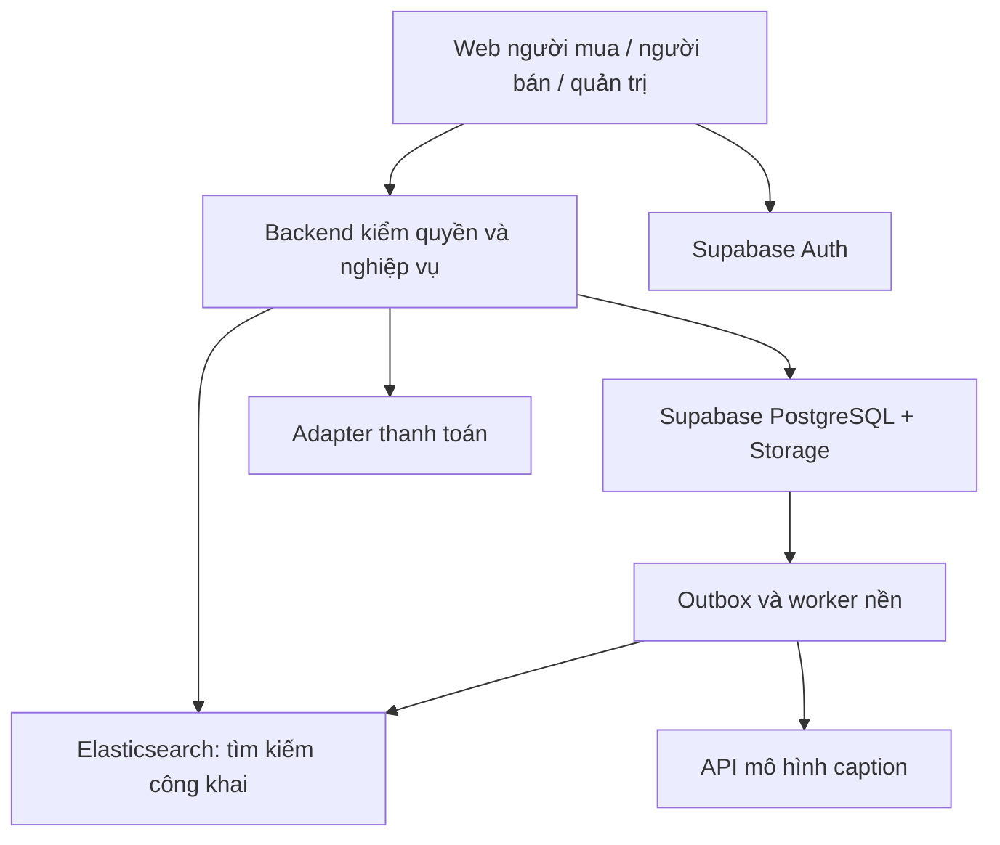

# Tổng quan sàn

## Mục tiêu

Một ứng dụng web responsive cho nhiều người bán độc lập. Người mua khám phá sản phẩm, tìm kiếm, đặt hàng và chat với shop. Người bán quản lý sản phẩm, biến thể, tồn kho, đơn và nhận bản nháp caption từ ảnh. Quản trị vận hành kiểm duyệt, xử lý báo cáo và kiểm soát quyền.

Giả định khởi đầu: Việt Nam, tiếng Việt, VND, hàng vật lý, mỗi người bán có một shop trong MVP nhưng schema hỗ trợ thành viên và nhiều shop. Người mua đồng thời có thể là người bán; vai trò không loại trừ nhau. Tên ứng dụng tạm gọi “Sàn”; không phải tên thương hiệu đã chốt.

## Phạm vi MVP

Google/OTP số điện thoại; hồ sơ và địa chỉ; mở shop có duyệt; danh mục; sản phẩm/biến thể/ảnh; tìm kiếm Elasticsearch; giỏ nhiều shop; đơn tách theo shop; COD và adapter thanh toán sandbox; chat riêng; caption bản nháp; quản trị tối thiểu và audit.

Giai đoạn sau: voucher phức tạp, tích hợp vận chuyển, đổi trả nâng cao, đối soát và chi trả thực cho người bán, khuyến mại. Livestream, ví/escrow tự quản, quảng cáo và mô hình gợi ý ngoài phạm vi mặc định. Tương đồng Shopee/Lazada là định hướng luồng nghiệp vụ, không cam kết đầy đủ tính năng hoặc cùng quy mô.

## Kiến trúc đề xuất

Realtime phân phối thông báo/chat qua kênh riêng; tin nhắn bền vững nằm ở PostgreSQL. Sơ đồ không thể hiện mọi kết nối: backend xác thực token Supabase; worker truy cập DB bằng quyền hạn chế. UI chỉ dùng SDK trực tiếp cho Auth và kênh realtime được phân quyền; nghiệp vụ ghi dữ liệu qua backend.

## Quyết định cốt lõi

| Thành phần | Trách nhiệm | Không đảm nhiệm |
|---|---|---|
| PostgreSQL | Tài khoản nghiệp vụ, shop, catalog, đơn, chat, sổ giao dịch | Mô hình AI |
| Supabase Auth | Định danh và phiên | Quyết định quyền tài nguyên thay backend |
| Storage | Ảnh công khai đã duyệt, file riêng theo policy | Cho mọi người đọc mọi bucket |
| Elasticsearch | Search, gợi ý từ khóa, filter, sort | Giá/tồn kho chính thức khi thanh toán |
| Caption service | Sinh nội dung dự thảo | Tự công bố hoặc khẳng định chất lượng |
| Payment provider | Xử lý thanh toán theo hợp đồng đã chọn | Được giả định tự có escrow/chia tiền |

## Mục tiêu vận hành đề xuất

Trang catalog không bị chặn bởi AI. Search lỗi có phương án truy vấn PostgreSQL đơn giản, vẫn áp cùng điều kiện hiển thị. Job có retry giới hạn và hàng lỗi; ghi thời gian đồng bộ để đo độ trễ index. Mục tiêu ban đầu: search p95 dưới 800 ms ở tải kiểm thử đã công bố, thay đổi catalog được phản ánh trong 60 giây thông thường. Đây là mục tiêu thiết kế, chưa phải benchmark.

Chưa chọn hosting hay gói dịch vụ. Tách dev/staging/prod; dự trù chi phí SMS, Elastic, DB/Storage, model inference và traffic trước production. Không gắn đặc tả vào một nhà cung cấp triển khai duy nhất.
